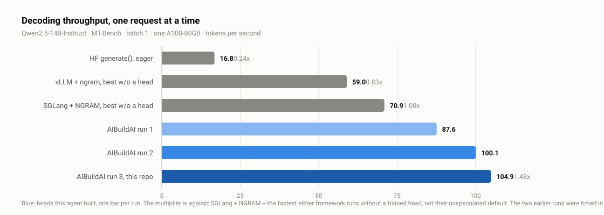
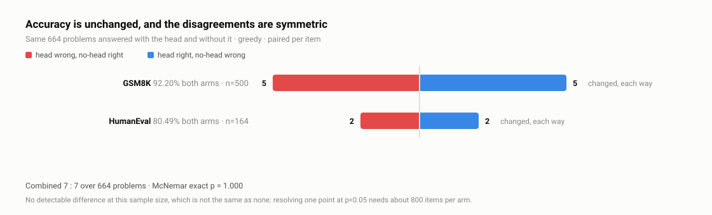

<h1 align="center">AIBuildAI LLM-Inference Agent</h1>

<h3 align="center">A draft head built end to end by an agent, serving 1.48x faster than SGLang and 1.78x faster than vLLM</h3>

---

<p align="center">
  <a href="docs/aibuildai-llm-inference-agent.pdf"></a>
  <a href="https://join.slack.com/t/aibuildaicommunity/shared_invite/zt-4a40v9kus-bQr~NIAZSKJkTwYxj5Elww"></a>
  <a href="https://discord.gg/JWrbhmkV6k"></a>
</p>

---

Large language models (LLMs) are now widely deployed in chat assistants, coding
tools and autonomous agents, where generation speed directly determines
responsiveness and user experience. Speculative decoding accelerates generation
by using a lightweight draft model to quickly propose several tokens, which the
target LLM then verifies in a single forward pass. Its speedup therefore depends
on how closely the draft model approximates the target LLM, and **building such a
draft model for each LLM requires substantial expertise and manual effort**.

To address this, we present the AIBuildAI Inference Agent, a recursive
self-improving agent that automatically builds high-speed LLM inference
engines by training high-performing EAGLE draft heads, lightweight draft models
built on the target LLM's internal features. In each iteration, the agent
proposes a draft-head design, spanning architecture, training data, training
procedure and draft-tree configuration, and trains the head. Its speedup is
then measured by a separate scoring program that the agent cannot access, which
prevents reward hacking. The proposed design and its results are then passed to
the next iteration, where the agent further improves on them. In addition, the
AIBuildAI Inference Agent contains a knowledge base of past experimental
findings that reduces the expertise and computation this search requires; the
knowledge base is updated after every run, so the agent improves over time.

Experiments show that the agent's automatically built draft head makes
generation **1.48x faster than SGLang**, **1.78x faster than vLLM**, and **6.2x
faster than a HuggingFace generation loop, with unchanged accuracy**.
Specifically, the results are measured on Qwen2.5-14B-Instruct served one request
at a time on one NVIDIA A100 GPU, **after the agent ran for 36 hours with no
human involvement**. The resulting engine reaches **104.9 tokens per second** on
MT-Bench, against **70.9 for SGLang** and **59.0 for vLLM**, each running its own
built-in n-gram speculation, with identical accuracy on GSM8K and HumanEval.

This repository is its source code, for running from source, reading, and
modifying.

## Current Results

The result below is for one target model; the recipe is not specific to it
(see **Scope**).

<p align="center">
  <picture>
    <source media="(prefers-color-scheme: dark)" srcset="assets/throughput-dark.svg">
    
  </picture>
</p>

Both baselines are each framework's own speculative decoding, enabled and measured
here: SGLang's `NGRAM` (a suffix automaton) and vLLM's `ngram` (prompt lookup).
Neither needs a checkpoint or any training -- one flag -- so they are what a user
has for free, and they are a harder baseline than running with speculation off:
on this benchmark `NGRAM` is worth **+35.8%** to SGLang (70.932 vs 52.214 tok/s).
That one substitution moves the headline from 2.0x to 1.48x.

How much vLLM's own speculation buys *it* on MT-Bench is not known here: no
unspeculated vLLM arm was measured on this benchmark, so 59.0 stands as an
absolute figure. On the shorter 30-prompt harness, where both vLLM arms were
measured, `ngram` is worth +9.7% over its matched control -- and only +1.0% over
vLLM's best non-speculative configuration, because enabling it forces the V1
model runner and disables async scheduling. `RESULTS.md` has the full table.

`eval/` has a vLLM arm only for the draftless modes: vLLM refuses to load a draft
head whose vocabulary size differs from the target's, and has no EAGLE
implementation for Qwen2.5, so our head cannot be measured there at all.

<p align="center">
  <picture>
    <source media="(prefers-color-scheme: dark)" srcset="assets/quality-dark.svg">
    
  </picture>
</p>

Full numbers and their caveats: **[RESULTS.md](RESULTS.md)**.
How the head was built: **[RECIPE.md](RECIPE.md)**.
The method and every measurement in one document:
**[the technical report](docs/aibuildai-llm-inference-agent.pdf)**.

## Requirements

- 1 GPU with >= 60 GB free (measured on A100-SXM4-80GB)
- `Qwen/Qwen2.5-14B-Instruct` (~28 GB) reachable by `huggingface_hub`
- a C++ host compiler `nvcc` accepts -- flashinfer JIT-compiles kernels on first
  use. A system `g++` works; if the machine has none,
  `conda install -c conda-forge gxx_linux-64=12.4 gcc_linux-64=12.4` into the
  serving environment; the harness finds the prefixed compiler and points nvcc
  at it, so no symlinks are needed. Without a host compiler the first arm fails
  with `nvcc fatal : Failed to preprocess host compiler properties`
- `conda` (miniforge is fine). A bare GPU image usually has neither conda nor
  a Python the framework accepts (`>=3.11,<3.14`); Quickstart A step 1 installs
  it in three commands
- The exact versions in `requirements-frozen.txt`. The ones that matter:
  `torch 2.13.0+cu130`, `transformers 5.12.1`, `sglang 0.5.21`,
  `flashinfer 0.6.18`, `accelerate 1.15.0`
- **A one-line SGLang patch** (see below). Without it the head computes a
  different function and the measurement is meaningless.

## Installation

```bash
git clone https://github.com/aibuildai-inc/aibuildai-llm-inference-agent.git
cd aibuildai-llm-inference-agent
```

There is no single install step, because the three paths need different
environments: A and D serve the target with SGLang, B only trains, and C runs the
agent framework. Each path below installs its own, in commands verified on a
fresh machine. Start with the one you want.

## Configuration

Quickstart C runs agents on the machine that holds the GPUs, so that machine
needs model access -- a Claude Code login, or the source-build skip flag. A
search launched without it does not fail, it retries forever at zero tokens; the
callout in Quickstart C has the commands.

| Environment variable | Purpose |
|---|---|
| `HF_HOME` | Hugging Face cache; the target needs ~28 GB, and the default `~/.cache` is often too small |
| `TMPDIR` | Scratch for the JIT cache and the packaged draft dir; point it at a large disk if `/tmp` is small |
| `SPECDEC_JIT_CACHE` | flashinfer JIT cache (default `$TMPDIR/specdec-jit-cache`) |
| `SPECDEC_TASK` | Task folder `eval/run_eval.sh` measures against (default `task/`) |
| `SPECDEC_HEAD` | Head weights to measure (default `heads/draft_head.pt`); `--head` overrides it |
| `SPECDEC_RESULTS` | Where an evaluation writes its arms (default `eval/results`); `--results` overrides it |
| `PYTHON` | Interpreter `eval/run_eval.sh` uses, when it is not the one on `PATH` |
| `AIBUILDAI_SKIP_SUBSCRIPTION_CHECK` | Set to `1` when running the framework from source without a subscription check |
| `AIBUILDAI_CLIPROXYAPI_SOURCE_COMMIT` | Pins the proxy component the framework builds; the value is in Quickstart C |

## Usage

### Four ways in

A, B and C are independent; D measures what B or C produced.

| | needs | gives you |
|---|---|---|
| **A** verify the published number | the head weights, no training | the 2.0089x reproduced, or a number to compare |
| **B** train your own head | a GPU and hours | a head of your own from this recipe |
| **C** re-run the end-to-end search | a GPU, and either an AIBuildAI login or the source-build skip flag; 5--6 h per step (17 h to verify, 36 h for all ten) | the agent builds a head from the task contract |
| **D** evaluate the head C produced | a head from B or C | your head on the same protocol as the published one |

### Quickstart A — verify the published number

These are the commands as run on a second machine, in this order.

```bash
git clone https://github.com/aibuildai-inc/aibuildai-llm-inference-agent.git
cd aibuildai-llm-inference-agent

# 1. conda, if the machine has none. Everything below lives in conda
#    environments; a bare GPU image usually ships neither conda nor a
#    Python new enough for the framework (Ubuntu 22.04 ships 3.10).
curl -L -o /tmp/miniforge.sh \
  https://github.com/conda-forge/miniforge/releases/latest/download/Miniforge3-Linux-x86_64.sh
bash /tmp/miniforge.sh -b -p ~/miniforge3
~/miniforge3/bin/conda init bash && exec bash
#    `exec bash` replaces the shell, so paste the rest AFTER it returns

# 2. the serving environment: torch + SGLang + flashinfer for YOUR CUDA, plus a
#    host compiler for flashinfer's JIT. The harness reads CXX/CC from this
#    interpreter's own bin/, so install the compiler INTO this env.
nvidia-smi --query-gpu=name,memory.total,driver_version --format=csv
#    the CUDA build below must match that driver; cu130 needs driver >= 580
conda create -y -n sglang-baseline python=3.12
conda activate sglang-baseline
pip install torch==2.13.0 torchvision==0.28.0 torchaudio==2.11.0 \
  --index-url https://download.pytorch.org/whl/cu130
pip install sglang==0.5.21 flashinfer-python==0.6.18 transformers==5.12.1 \
  accelerate==1.15.0 numpy safetensors pyyaml huggingface-hub
conda install -y -c conda-forge gxx_linux-64=12.4 gcc_linux-64=12.4

# CHECK the stack before going further
python -c "import torch, sglang, flashinfer, transformers; \
print(torch.__version__, sglang.__version__, flashinfer.__version__, transformers.__version__)"
python -c "import torch; print('cuda', torch.version.cuda, torch.cuda.is_available(), torch.cuda.get_device_name(0))"
x86_64-conda-linux-gnu-g++ --version | head -1
#    nvcc must be told WHICH host compiler: it looks for a plain `g++` on PATH,
#    conda-forge ships only the prefixed name, and a GPU image often has no
#    system g++ -- that combination fails with `cannot execute 'cc1plus'`.
#    The harness passes -ccbin for every real run; pass it here too.
echo 'int main(){return 0;}' > /tmp/t.cu
nvcc -ccbin "$CONDA_PREFIX/bin/x86_64-conda-linux-gnu-g++" /tmp/t.cu -o /tmp/tcu \
  && echo "nvcc+host OK"

# 3. patch SGLang -- NOT optional, and it must be the SGLang you just installed
./tools/patch_sglang.sh
./tools/patch_sglang.sh                  # idempotent: must say "already patched"

# 4. fetch the head weights (public release, no token needed)
curl -L -o heads/draft_head.pt \
  https://github.com/aibuildai-inc/aibuildai-llm-inference-agent/releases/download/v1.0.0/draft_head.pt
sha256sum heads/draft_head.pt
# expect 7a744703b50f49f9d5cb6ad04256e6a5ee81746b70d4426e3bd900980e371343

# 5. check prerequisites only (~2 min)
export HF_HOME="$HOME/hf-cache"          # needs ~28 GB for the target
export TMPDIR=/var/tmp                   # if /tmp is small
PYTHON="$(which python)" ./eval/run_eval.sh --check

# 6. run it -- 70 min+, so do it inside tmux (an ssh drop otherwise kills it)
tmux new -s eval

#    INSIDE tmux you get a fresh shell: the env and the exports above are NOT
#    inherited. Set them up again before running anything.
conda activate sglang-baseline
cd ~/aibuildai-llm-inference-agent
export HF_HOME="$HOME/hf-cache"
export TMPDIR=/var/tmp

PYTHON="$(which python)" ./eval/run_eval.sh --phase mtbench   # ~70 min, the headline number
PYTHON="$(which python)" ./eval/run_eval.sh --phase quality   # ~90 min, GSM8K + HumanEval
PYTHON="$(which python)" ./eval/run_eval.sh                   # all phases, ~4 h
```

Detach with `Ctrl-b d`, come back with `tmux attach -t eval`. If you skip the
re-activation, `which python` resolves to the system interpreter and the run
fails on the first import.

`--check` should print the versions, `sglang patch: OK`, `draft module :
imports`, `registry : Qwen2ForCausalLMEagle registered`, a GPU with >= 60 GB
free, and all three data files found.

`run_eval.sh` ends by running `summarise.py` itself; to re-print the comparison
later without re-measuring:

```bash
python eval/summarise.py --results eval/results --reference eval/REFERENCE.md
```

Compare your output with `eval/REFERENCE.md`. Anything within ~2% is a match --
that is the instrument's resolution, not slack. **A cold clone on a second
machine measured 1.9943x against the published 2.0089x -- 0.73% apart, with tau
identical to four decimals.**

### Quickstart B — train your own head

    cd train
    python prepare.py          # harvest teacher features (hours; writes data/)
    python train.py            # -> runs/<output_dir>/head.pt
    python eval.py             # advisory dev acceptance
    python export.py ../out    # -> ../out/full/{head.pt, head_config.json}

Everything is driven by `train/recipe.yaml`.

**The published head needs more than these four commands.** `recipe.yaml` names
`train_v4.pt`, the step-10 corpus, which exists only after the incremental chain
in `train/corpus/` -- `prepare.py` writes `train.pt`. Run the four commands above
and `train.py` says so and trains on `train.pt` instead, which yields a valid
head but not the published one. To reproduce the published corpus:

    python prepare.py                       # -> data/train.pt
    python corpus/gen_chat_aug.py           # -> data/chat_aug.pt
    python corpus/merge_corpus.py           # -> data/train_v2.pt
    python corpus/gen_rc_aug.py             # -> data/rc_aug.pt
    python corpus/merge_corpus_v3.py        # -> data/train_v3.pt
    python corpus/gen_rc_aug2.py            # -> data/rc_aug2.pt
    python corpus/merge_corpus_v4.py        # -> data/train_v4.pt

Both paths have been run from a clean clone: the four-command path trains on
`train.pt` and `export.py` hands `make_draft.py` a head that packages into a
16-tensor draft directory SGLang loads.

`train/README.md` explains what each increment added and why. The chain exists
because regenerating 6M tokens of teacher features costs hours; it was grown
across search steps rather than built in one pass.

### Quickstart C — re-run the end-to-end search

This is the agent that *found* the head, not the head. It needs no trained head
and no weights to start; it builds one from the task contract -- the part of the
work that is normally a human's, done by the agent rather than reproduced from
`RECIPE.md`.

> **Log into Claude Code on the machine that will run the search, before you do
> anything else.** The agents run there, not on your laptop, and they get their
> model access from that machine's own login. A search launched without it does
> not fail: it retries forever, with every request returning `api_error ... Not
> logged in` at 0 tokens and 0 cost, while the process stays up and the GPU
> stays idle. We lost three hours to this on a freshly imaged box.
>
> ```bash
> # install Claude Code if the machine does not have it (a fresh GPU image
> # will not). The installer puts the binary in ~/.local/bin:
> curl -fsSL https://claude.ai/install.sh | bash
> export PATH="$HOME/.local/bin:$PATH"     # add to ~/.bashrc to make it stick
> claude --version                         # expect 2.x (Claude Code)
> # npm alternative: npm install -g @anthropic-ai/claude-code
>
> claude                              # complete the login, then /exit
> ls -l ~/.aibuildai/claude_token     # must exist and be non-empty
> ```
>
> If the machine was just wiped or re-imaged, assume you are logged out even if
> `~/.claude` exists -- a config skeleton is not a session.

    # 0. TWO separate authorisations, and the skip flag covers only ONE of them.
    #
    #    a) MODEL access, from Claude Code itself. Without it every agent request
    #       ends `api_error ... Not logged in` with 0 input and 0 output tokens,
    #       and the run spins in a retry loop that looks alive for hours: the
    #       process is up, launcher scripts pile up, no artefact is ever written.
    #       There is no skip flag for this.
    #       Install it first if the machine has none (see the callout above):
    #         curl -fsSL https://claude.ai/install.sh | bash
    claude                                          # log in, then /exit
    ls -l ~/.aibuildai/claude_token                 # must exist and be non-empty
    #
    #    b) the RUN GATE: `aibuildai run` fetches a signed lease and fails closed.
    #       From source you can skip that verdict; a frozen binary cannot.
    export AIBUILDAI_SKIP_SUBSCRIPTION_CHECK=1      # or: aibuildai login

    # 1. install the framework (the order matters -- packages/ first).
    #    Assumes conda exists; if not, install miniforge first (Quickstart A
    #    step 1). Use conda, not venv: the framework needs Python >= 3.11,
    #    Ubuntu 22.04 ships 3.10, and `python3 -m venv` fails without
    #    python3-venv.
    conda create -y -n aibuildai python=3.12
    conda activate aibuildai

    #    The toolchain goes INTO this env, not into base or sglang-baseline:
    #    the framework builds PostgreSQL 18.6 from source on first run, cannot
    #    use a system one, and looks for bison/flex/make/gcc in the active env.
    #    Running this before `conda activate aibuildai` installs it in the
    #    wrong place and the build fails.
    conda install -y -c conda-forge bison flex make gxx_linux-64=12.4 gcc_linux-64=12.4

    export AIBUILDAI_CLIPROXYAPI_SOURCE_COMMIT=21c3972447b7b51b0c86bb53f4e2552bac2526a4
    cd framework
    pip install -c requirements.lock -e ./packages/execution
    pip install -c requirements.lock -e ./packages/conversation
    pip install -c requirements.lock -e .
    cd ..

    # 2. confirm it installed as the revision that produced the result
    aibuildai -V                 # AIBuildAI science-2026-08-04+439.gd4c0692e7.dirty
                                 # 0.0.0+unknown here means _version.py did not survive the clone

    # 3. patch SGLang -- NOT optional, and patch the env the RUN will use:
    #    run_config names `conda_env: sglang-baseline`, which must already exist
    #    (Quickstart A step 1). launch.sh verifies it before starting.
    conda activate sglang-baseline && ./tools/patch_sglang.sh
    conda activate aibuildai

    # 4. launch (10 steps, 48 h budget; the published run used 36 h).
    #    launch.sh ends in `exec aibuildai run`, i.e. a FOREGROUND process, so
    #    run it inside tmux or an ssh drop kills the search.
    tmux new -s search
    #    inside tmux the shell is fresh -- nothing above is inherited:
    conda activate aibuildai
    cd ~/aibuildai-llm-inference-agent
    export AIBUILDAI_CLIPROXYAPI_SOURCE_COMMIT=21c3972447b7b51b0c86bb53f4e2552bac2526a4
    export AIBUILDAI_SKIP_SUBSCRIPTION_CHECK=1       # if you used the skip flag
    export HF_HOME="$HOME/hf-cache" TMPDIR=/var/tmp

    ./search/launch.sh [playground-dir]      # default ~/aibuildai-playground
    #    detach with Ctrl-b d, come back with `tmux attach -t search`

    # 4b. CHECK IT IS ACTUALLY WORKING -- do this in the first five minutes.
    #     An auth loop costs nothing and produces nothing, so it can run all
    #     night looking healthy. A working run writes tokens and artefacts.
    P=$(ls -d ~/aibuildai-playground/*/*/ | tail -1)
    grep -c api_error "$P"/workspace/search_1/*/runs/run_1/execution.md   # want 0
    tail -3 "$P"/workspace/search_1/*/runs/run_1/execution.md             # want Input/Output > 0
    #     If you see `Not logged in` or `Input: 0 · Output: 0`, stop the run,
    #     do step 0a, and relaunch. It will not recover on its own.

    # 5. the workspace UI. launch.sh prints
    #      AIBuildAI Workspace: http://127.0.0.1:<port>/run/<id>
    #    TWO things make that link fail if you just paste it elsewhere:
    #      a) 127.0.0.1 is the REMOTE machine's loopback, so forward the port
    #         (it changes every run). Any of these works:
    #           ssh -N -L <port>:127.0.0.1:<port> user@host
    #           gcloud compute ssh <instance> --zone <z> -- -L <port>:127.0.0.1:<port>
    #           VS Code Remote-SSH -> PORTS -> Forward a Port -> <port>
    #      b) /run/<id> is a client-side route and the server 404s it.
    #         Open the ROOT, http://127.0.0.1:<port>/ , and pick the run there.
    #    Check it is up without a browser:
    #      curl -s http://127.0.0.1:<port>/api/v1/runs

    # 5. watch it
    ./search/watch_run.sh ~/aibuildai-playground
    for f in $(find ~/aibuildai-playground -name .program-result.json \
                    -path '*score_program*' | sort -V); do
      python3 -c "import json;o=json.load(open('$f'))['output'];print(round(o['score'],4), o['components'])"
    done
    cat ~/aibuildai-playground/*/workspace/search_1/worker_*/state/artifacts/README.md

A step is sound when `gate_passed` is 1.0 **and** its baseline sits in the
52.2--52.5 tok/s band; a baseline outside that band means the instrument moved
and the ratio is not comparable.

**What a from-scratch run produced**, on one A100, starting from this repo:

| step | what the agent changed | score | tau | baseline |
|---|---|---|---|---|
| 1 | built the pipeline; tree sweep, width, then on-policy data (1.41M tokens) | 1.8671 | 3.028 | 52.457 |
| 2 | on-policy volume 1.41M -> 2.49M | 1.9612 | 3.194 | 52.434 |
| 3 | on-policy volume 2.49M -> 3.71M | 2.0068 | 3.279 | 52.460 |

About 5--6 hours per step. **Three steps is enough to verify the machinery** --
it crosses 2.0x and the baselines agree to 0.05%; the remaining seven chase the
end point. If the machine dies mid-run, the run does not resume: the scored
steps and their written records survive on disk, the in-flight step does not.
Read the records, then launch a fresh run rather than restarting the old one.

**Read `search/README.md` before launching.** It covers what the repository
cannot supply -- a Claude Code login (no API key needed), a conda environment
holding torch/SGLang/flashinfer, one GPU with >= 60 GB free, ~200 GB of disk --
and two things that will otherwise surprise you:

* a re-run writes its **own** scorer from the task contract, so two runs of the
  same search can be scored differently. `search/score.reference.py` is the one
  the published run used, to diff against or to pin;
* a re-run will **not** retrace the published trajectory. Each step is an agent
  forming its own hypothesis. What should reproduce is the default baseline
  (52.30--52.43 tok/s across all ten scored steps) and roughly the end point.

### Quickstart D — evaluate the head your own search produced

Quickstart A measures the *published* head. A search (C) or a local training run
(B) leaves a different one, in a different layout: `head.pt` and
`head_config.json` side by side, where `run_eval.sh` expects `<name>.pt` and
`<name>.config.json`. One command bridges that:

```bash
conda activate sglang-baseline
export HF_HOME="$HOME/hf-cache" TMPDIR=/var/tmp

# the search writes its delivered head here
D=$(ls -d ~/aibuildai-playground/*/*/ | tail -1)
ls "$D"/workspace/search_1/worker_*/state/artifacts/full/   # head.pt head_config.json

./tools/eval_search_head.sh "$D"/workspace/search_1/worker_7/state/artifacts/full mtbench
```

It stages the pair under the names the harness wants and runs the same MT-Bench
protocol as Quickstart A, writing into **its own results directory**
(`~/specdec-eval-head/results` by default, override with `SPECDEC_RESULTS`).
Pass `quality` instead of `mtbench` for GSM8K + HumanEval.

That separation matters: result files are named by arm, not by head, so a second
head written into `eval/results/` would overwrite the published head's numbers
and a later `summarise.py` would mix one head's speed with another's quality --
which is invisible in the output. `run_eval.sh` now stamps each result with the
head's sha256 and `summarise.py` refuses to summarise across a change of head.

Two things to know before reading the result:

* **The tree travels with the head.** `make_draft.py` does not copy
  `sglang_overrides` into the draft directory, and the benchmark reads them from
  `_overrides.json` *inside* that directory. `run_eval.sh` now writes that file
  from your `head_config.json`, so a head tuned for, say, 4/24/64 is no longer
  measured at the task default 3/24/64 and under-reported. If your head's config
  names no overrides, the defaults apply and that is correct.
* **`eval/REFERENCE.md` describes the published head, not yours.**
  `summarise.py` will compare against it and print a mismatch; that is a
  different head, not a failed reproduction. What matters is the plain and draft
  tok/s pair measured in your own session, and their ratio.

### The SGLang patch

`tools/patch_sglang.sh` edits `sglang/srt/models/qwen2_eagle.py` in your
installed SGLang. The default file deletes the draft layer's `input_layernorm`,
which this head needs: with the layernorm removed the head computes a different
function (relative error 1.84 against the reference implementation, versus
7.7e-17 with the patch). The script matches on structure rather than line
numbers, is idempotent, and refuses to apply twice.

`eval/run_eval.sh --check` verifies the patch is present and will not run
without it. The script keeps the original beside the patched file, so to revert:

```bash
F=$CONDA_PREFIX/lib/python3.12/site-packages/sglang/srt/models/qwen2_eagle.py
cp "$F.orig" "$F"
```

## Outputs

A search writes one run home per run:

```
{playground}/<task-name>/<timestamp>_<run-id>/
  run_config.json          the final configuration and the run id
  public/                  what every step reads: the frozen task README and the data Setup prepared
  private/                 the score program, the metric manifest, the baseline attempt
  workspace/search_1/      worker_1..N (one per step), records/, score_program_1..N, code/
  deliverable/             the delivered head: head.pt + head_config.json
  program-environment/     the environment the run built for itself
  resource_samples.jsonl   host resource samples over the run
```

`workspace/search_1/records/worker_N` is the written record step N+1 reads, and
`score_program_N/.../.program-result.json` holds the score that step earned.
Quickstart D measures a delivered head on the same protocol as the published one.

## Method

**The task.** Speculative decoding needs a draft head trained for one target
model, and the choices interact: the head's width and depth, the data it learns
from, the training objective, and the draft-tree shape the server runs it with.
Each candidate costs hours, because a head must be trained before it can be
timed, so only ten or so fit in a budget.

**The search.** Each step is one complete experiment -- build, train, time --
run by a fresh agent that inherits only the written record of the steps before
it. A step changes one thing, measures it, and writes down what moved and what
did not, including the ideas that failed. That record is the only channel
between steps, which is what keeps a step's claim auditable.

**The score contract.** A separate program with its own GPUs re-times both arms
after the step's session has closed and returns the speedup. If any of its
checks fails the step is marked failed rather than given a low score, so a head
that silently never loaded cannot score at all.

**What improves between runs.** The records are folded back into the written
guides a later run starts from, so three successive runs on this task reached
1.664x, 1.900x and 2.0089x without the method changing. `RECIPE.md` is the
current state of that knowledge, and `search/task/skills/` holds the guides the
agents read.

## Project layout

```
train/       build a head of your own (the code that produced this one)
  recipe.yaml      the config that drives prepare/train/eval/export
  prepare.py       harvest teacher features from the target
  head_model.py    the trainable head
  train.py         multi-step (unroll) feature regression
  eval.py          advisory dev acceptance
  export.py        -> head.pt + head_config.json
  corpus/          the incremental corpus augmenters (read train/README.md)
task/        the measuring instrument -- do not edit
  models.json      target, engine settings, the draft tree, tunable bounds
  prompts.json     the 30 fixed prompts, pre-tokenised
  harness/         make_draft.py, benchmark.py, check_draft.py, _engine_arm.py
  reference_head.py    reference head implementation, validated against the target
eval/        literature-protocol evaluation
  run_eval.sh      MT-Bench (T=0/T=1) + HF eager + GSM8K + HumanEval
  PROTOCOL.md      what is measured and why it is measured that way
  REFERENCE.md     our numbers, to diff yours against
docs/        the method knowledge, as standalone notes
  recipe.md measurement.md exactness.md methods.md performance-model.md
tools/       patch_sglang.sh, eval_search_head.sh
heads/       how to obtain the weights
search/      re-run the autonomous search that found the head
  task/            the task folder the framework reads as data_root
  task/skills/     the seven knowledge documents the agents read
  run_config.yaml  the configuration that produced this head
  score.reference.py   the scorer the winning run wrote (a re-run writes its own)
```

`task/` is the instrument: `models.json`, `prompts.json` and `harness/` decide
whether a number means anything. Treat them as read-only. If you change them you
are measuring something else, and `eval/REFERENCE.md` no longer applies.

## Reapplying the method elsewhere

`RECIPE.md` states what moved the number and what did not, with the
measurements, so the recipe can be taken to another target. `docs/` holds the
same knowledge as standalone notes.

Quickstarts A and B need no agent framework at all -- `RECIPE.md` and
`train/recipe.yaml` capture what the search converged on, so the recipe is
usable without ever running an agent. Only C needs `framework/`.

## Scope

This is one layer of the inference stack. Nothing here builds or modifies a
serving framework: the artefact is a speculator that an existing framework
loads, and it is measured against that framework's own unspeculated throughput,
so the number reported is the head's contribution and not the framework's.

Measured on one target, one GPU model, one SGLang version. The recipe has been
applied to a second, much larger target (a 123B dense model at tensor-parallel
4, reaching 2.12x on the same internal harness), which suggests it is not
specific to Qwen2.5-14B -- but that result is not part of this repository and
was not evaluated on MT-Bench.

## Citation

The technical report for this line is
[`docs/aibuildai-llm-inference-agent.pdf`](docs/aibuildai-llm-inference-agent.pdf);
its paper is to be released. Until then, cite the AIBuildAI papers:

```bibtex
@article{zhang2026aibuildai,
    title={AIBuildAI: An AI Agent for Automatically Building AI Models},
    author={Ruiyi Zhang and Peijia Qin and Qi Cao and Li Zhang and Pengtao Xie},
    year={2026},
    journal={arXiv},
    url={https://arxiv.org/abs/2604.14455}
}

@article{zhang2026aibuildai2,
    title={AIBuildAI-2: A Knowledge-Enhanced Agent for Automatically Building AI Models},
    author={Ruiyi Zhang and Peijia Qin and Qi Cao and Li Zhang and Pengtao Xie},
    year={2026},
    journal={arXiv},
    url={https://arxiv.org/abs/2605.27873}
}

@article{qin2026aibuildai25,
    title={AIBuildAI-2.5: Efficient Autonomous AI Model Development Through LLM-Guided Tree Search},
    author={Peijia Qin and Ruiyi Zhang and Qi Cao and Han Guo and Li Zhang and Pengtao Xie},
    year={2026},
    journal={arXiv},
    url={https://arxiv.org/abs/2609.25047}
}
```

## License

This repository's code and documentation are MIT licensed (`LICENSE`).

The three bundled evaluation datasets and the target model keep their own terms,
and the draft head weights are derived from self-distilled outputs of the target
model -- see `DATA_AND_LICENSES.md` before redistributing any of those.

## Community

Questions and discussion: join the [AIBuildAI Community Slack](https://join.slack.com/t/aibuildaicommunity/shared_invite/zt-4a40v9kus-bQr~NIAZSKJkTwYxj5Elww)
or the [AIBuildAI Community Discord](https://discord.gg/JWrbhmkV6k). Use the
issue tracker for bugs and feature requests.

## Contact us

For enterprises interested in adopting or deploying the AIBuildAI LLM-Inference
Agent at scale, including technical consulting, custom inference engagements, or
partnership inquiries, contact us at pengtao.xie@aibuildai.io.

Long-term active contributors to this repository are eligible for coding agent
sponsorship, such as Claude Code, Cursor, or OpenAI Codex. Email
pengtao.xie@aibuildai.io with your most important commits or pull requests.
